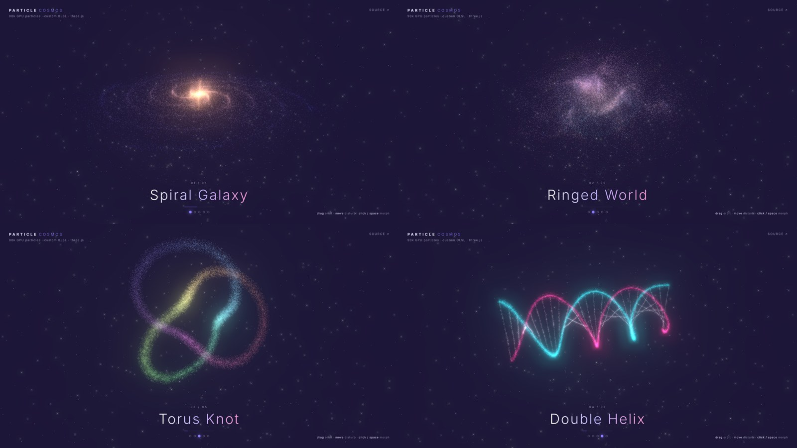

# Particle Cosmos

**90,000 GPU particles that morph between cosmic shapes**, built with [three.js](https://threejs.org) and custom GLSL shaders. No build step and no dependencies: it's one HTML page and ES modules.

### [▶ Live demo](https://yrogovich.github.io/threejs/)



## Features

- **Five procedural formations**: Spiral Galaxy, Ringed World, Torus Knot, Double Helix and Gravity Wave, each generated from math in [`src/shapes.js`](src/shapes.js).
- **Shader-driven morphing**: every particle interpolates on the GPU with a per-particle delay, and 3D simplex noise turns each transition into a swirling storm.
- **Interactive force field**: move the cursor and particles scatter away from it, glowing as they go.
- **Cinematic look**: additive blending, `UnrealBloomPass`, twinkling point sprites and a parallax starfield.
- **Responsive**: halves the particle count on mobile and caps pixel ratio for steady frame rates.

## Controls

| Input | Action |
| --- | --- |
| Drag / scroll | Orbit and zoom |
| Move cursor | Disturb the particles |
| Click, `Space`, `→` | Morph to the next shape |
| `←` | Previous shape |
| Dots | Jump to a shape |

Shapes also auto-advance every 8 seconds.

## How it works

Each shape is a `Float32Array` of positions and colors. The geometry holds two position sets (`position` → `aTarget`). A `uProgress` uniform runs from 0 to 1, and the vertex shader does the rest:

```glsl
float p = clamp((uProgress - aRandom * 0.45) / 0.55, 0.0, 1.0); // staggered start
p = p * p * (3.0 - 2.0 * p);                                   // smoothstep ease
vec3 pos = mix(position, aTarget, p);
pos += noise3(pos) * (0.07 + sin(p * PI) * 1.8);               // turbulence peaks mid-morph
```

The CPU only copies arrays when a morph starts. Everything per frame runs on the GPU.

## Run locally

Any static server works:

```bash
npx serve .
# or
python3 -m http.server
```

Then open http://localhost:3000 (or :8000).

## Project structure

```
index.html        page, overlay UI, import map for three.js
style.css         overlay styling
src/main.js       renderer, post-processing, morph state machine, input
src/shapes.js     procedural shape generators
src/shaders.js    particle + starfield GLSL (simplex noise included)
```

## License

MIT
